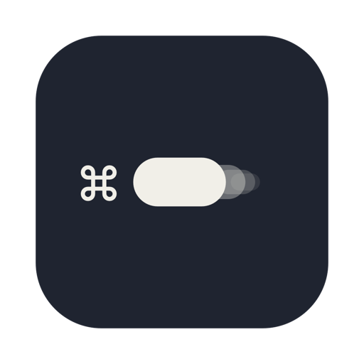
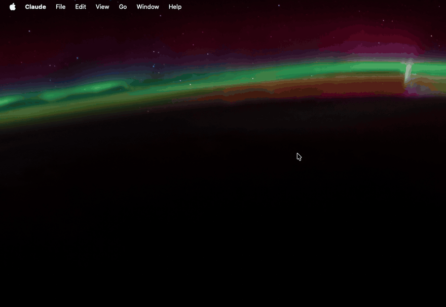
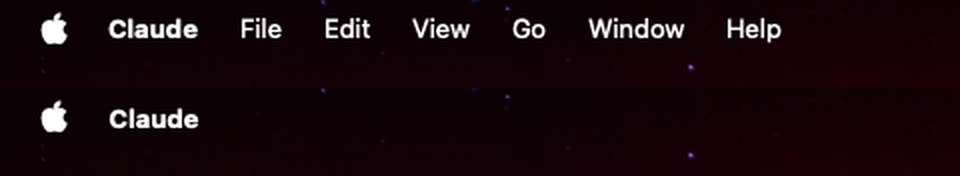
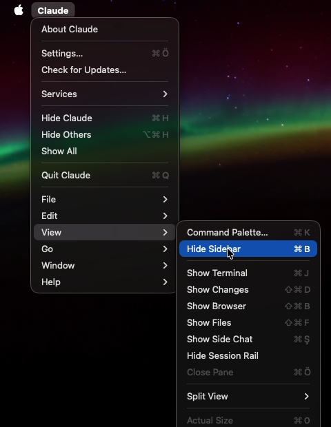

<p align="center">
  
</p>

<h1 align="center">Tuck</h1>

<p align="center">
  <b>A quieter menu bar for macOS.</b><br>
  Tuck folds every app's File, Edit, View… menus under the app's name and leaves only the name in sight.
</p>

<p align="center">
  <b>English</b> · <a href="README.tr.md">Türkçe</a>
</p>

<p align="center">
  
</p>

---

The left half of the macOS menu bar is a row of menus you open a few times a day: *File, Edit, View, Go, Window, Help*, and in some apps ten more. Tuck takes that row away and keeps just the app's name. Click the name and every menu is there, one level down.

Tuck is built around three ideas:

1. **Only the name stays.** Next to the Apple menu you see the name of the app you are in, nothing else. There is no arrow or badge: once you know the menus live under the name, the name is enough.
2. **Nothing is lost.** Clicking the name opens the app's own menu with all its other menus as submenus. Choosing an item there presses the real item in the app, so everything works exactly as before. Keyboard shortcuts never go through Tuck and keep working as usual.
3. **It looks like it was always like this.** Tuck draws the desktop behind the strip it lays over the menus, live, so even moving wallpapers like Aerials stay seamless. On a screen showing a full-screen app it steps aside.

It works with every app that has a menu bar, from Finder and Safari to Electron apps. Nothing leaves your Mac: there is no account, no network access and no tracking.

*Tuck* means to fold something away out of sight. Tuck's own menu is available in English and Turkish.

## Contents

- [What changes](#what-changes)
- [Opening the menus](#opening-the-menus)
- [Every app, every screen](#every-app-every-screen)
- [The menu bar icon](#the-menu-bar-icon)
- [Installation](#installation)
- [Permissions and privacy](#permissions-and-privacy)
- [Keeping permissions across builds](#keeping-permissions-across-builds)
- [How it works](#how-it-works)
- [Limitations](#limitations)
- [Building and contributing](#building-and-contributing)
- [License](#license)

## What changes

<p align="center">
  
</p>

Top: the menu bar as macOS shows it. Bottom: the same app with Tuck running. The Apple menu and everything on the right side of the menu bar (the clock, Control Center, other apps' icons) stay exactly as they are; Tuck only touches the row of menus that belongs to the app in front.

## Opening the menus



Click the app's name. One menu opens:

- **At the top, the app's own menu:** *About*, *Settings…*, *Hide*, *Quit* and whatever else the app keeps there, exactly as it would appear if you clicked its name normally.
- **Below a separator, every other menu as a submenu:** *File*, *Edit*, *View*… in the app's own order. Hover one to open it.

Items show their check marks, their keyboard shortcuts and whether they are available right now, because Tuck reads all of that from the app the moment you open the menu. Large menus like *Bookmarks* or *History* are read only when you hover them, so the menu opens instantly even in apps with hundreds of items.

Choosing an item presses that same item in the app. The app doesn't know the difference.

<br clear="right">

## Every app, every screen

<p align="center">
  
</p>

- **Every app:** switch apps and the name follows. Apps that change their menus while you work, for example when you switch tabs or windows, are followed too.
- **Multiple displays:** with *Displays have separate Spaces* on (the macOS default), every display has its own menu bar, and Tuck lays its strip on each of them.
- **Full screen:** when an app goes full screen, or you double-click a video into full screen in your browser, that display's menu bar hides itself. Tuck notices and removes its strip from that display while the others stay tucked. This also works on MacBooks with a notch, where the full-screen app starts below the menu bar.

## The menu bar icon

Tuck lives in the menu bar as a small icon and has no window or Dock icon. Its menu has three items:

| | |
|---|---|
| **Tuck menus** | Turn tucking on or off. Off, the menu bar is exactly the macOS one. |
| **Launch at login** | On by default: Tuck adds itself to your login items on first launch so it is always there. |
| **Quit Tuck** | Quit. The menus come back immediately. |

## Installation

Tuck needs **macOS 14 Sonoma or later** on **Apple Silicon**. There is no prebuilt download yet, so you build it yourself; it takes about a minute and needs only the Xcode Command Line Tools (`xcode-select --install`), not Xcode.

```sh
git clone https://github.com/serbestonline/Tuck.git
cd Tuck
./build.sh --install
open ~/Applications/Tuck.app
```

`build.sh` compiles Tuck, draws its icon and puts `Tuck.app` in `build/`; `--install` also copies it into the `Applications` folder in your home folder.

On first launch macOS asks for two permissions, described in the next section. Grant both, then quit Tuck from its menu bar icon and open it again, because macOS applies the screen recording permission only after a restart of the app.

> **Tuck isn't in the Screen Recording list?** macOS adds an app to that list only after it has tried to record once. Press **+** under the list, press **⌘⇧G**, paste `~/Applications/Tuck.app`, choose *Open* and switch it on.

To uninstall, quit Tuck, remove `~/Applications/Tuck.app`, and remove it from *System Settings › General › Login Items* and from the two privacy lists below.

## Permissions and privacy

Tuck asks for two permissions in *System Settings › Privacy & Security*. Both are needed, and each has one job.

| Permission | What Tuck does with it |
|---|---|
| **Accessibility** | Reads the menu bar of the app in front (names, positions, items, shortcuts) and presses the item you choose in the tucked menu. Without it Tuck does nothing. |
| **Screen & System Audio Recording** | Captures **only the desktop layer** (your wallpaper) behind the menu bar, twice a second, so the strip over the menus can redraw it. Windows, the menus themselves and Tuck's own strip are left out of the capture. Nothing is saved or sent anywhere, and Tuck never records audio. |

Tuck has no network code at all. It stores one preference (whether it has already added itself to login items) and nothing else.

## Keeping permissions across builds

macOS ties these permissions to an app's code signature. `build.sh` signs Tuck *ad hoc* by default, and an ad-hoc signature changes with every build, so after each rebuild macOS stops recognising Tuck and you would have to remove it from both lists and add it again.

To avoid that, sign with a certificate that stays the same:

1. Open **Keychain Access** and choose *Keychain Access › Certificate Assistant › Create a Certificate…*
2. Give it a name, set *Identity Type* to **Self Signed Root** and *Certificate Type* to **Code Signing**, and create it.
3. Build with that name:

```sh
TUCK_SIGN_IDENTITY="Your certificate name" ./build.sh --install
```

Grant the permissions once more after the first signed build; from then on they survive every rebuild. The certificate only lives in your keychain and is only valid on your Mac.

## How it works

macOS does not let one app remove another app's menus, so Tuck covers them instead.

1. **Reading.** When you switch apps, and twice a second while you stay, Tuck asks the app in front for its menu bar through the Accessibility API: where the app's name sits, where its last menu ends, and the menus themselves.
2. **Covering.** On every display's menu bar Tuck places a borderless strip one level above the menu bar. It starts right after the Apple menu, because the real menus' highlight reaches a few points past their edges, and it ends just after the last menu.
3. **Drawing.** Behind the strip Tuck draws a live capture of the desktop layer only, taken twice a second with ScreenCaptureKit, so the strip is the wallpaper itself; it then writes the app's name in the same bold menu bar font, in white or black depending on how bright the wallpaper is there.
4. **Mirroring.** Clicking the name builds a regular macOS menu from the app's menus. Submenus are filled the moment you hover them. Choosing an item sends the Accessibility *press* action to the real item.
5. **Full screen.** A full-screen app places a window as wide as the display over that display's menu bar. Normal windows and menu bar icons never do, so this is how Tuck knows to step aside on that display.

## Limitations

- **The real menus are still there, underneath.** Tuck covers them; it doesn't delete them. Keyboard navigation of the menu bar (*Control-F2*) and VoiceOver still reach them.
- **Menus filled on demand** (recent items, window lists) show their state at the moment you open the submenu.
- **Some shortcuts aren't shown** in the tucked menu, such as arrow keys or function keys, although they keep working in the app.
- **A menu bar background.** If *Show menu bar background* is turned on in System Settings, the strip, which draws the wallpaper, stands out from the bar.
- **Major macOS updates** can change how the menu bar is layered. If the strip ever looks wrong after an update, turn *Tuck menus* off from the icon and open an issue.

## Building and contributing

The project is a handful of Swift files and two scripts, compiled with `swiftc`; there is no Xcode project.

| File | What it does |
|---|---|
| `Sources/main.swift` | App start, the menu bar icon and its menu, permissions, launch at login, and the self-test |
| `Sources/MenuMirror.swift` | Reading the app's menu bar through Accessibility and mirroring it into the tucked menu |
| `Sources/Strip.swift` | The strip on each display: placement, full-screen detection and the live wallpaper capture |
| `Sources/Record.swift` | The recording mode that produces the GIFs in this README |
| `build.sh` | Builds `Tuck.app`, draws the icon and signs it |
| `scripts/make_icon.swift` | Draws the app icon |
| `scripts/make_media.sh` | Records Tuck and regenerates the images and GIFs in `assets/` |

```sh
./build.sh                                # build/Tuck.app
build/Tuck.app/Contents/MacOS/Tuck --selftest
./scripts/make_media.sh                   # moves the mouse for ~30 s; don't touch it
```

The self-test checks the geometry Tuck relies on: which display a menu bar belongs to, where the strip goes on a second display, and when a display counts as full screen.

Bug reports and ideas are welcome as issues.

## License

Tuck is **source available, not open source.** You may read the code, build it and use it on your own computers for personal, non-commercial use. Copying, redistributing, publishing modified versions and commercial use need written permission. See [LICENSE](LICENSE) for the full text.
