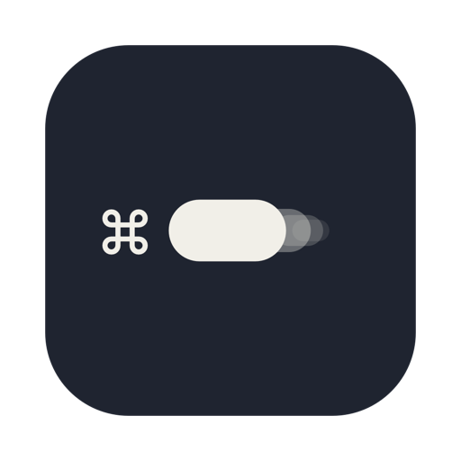
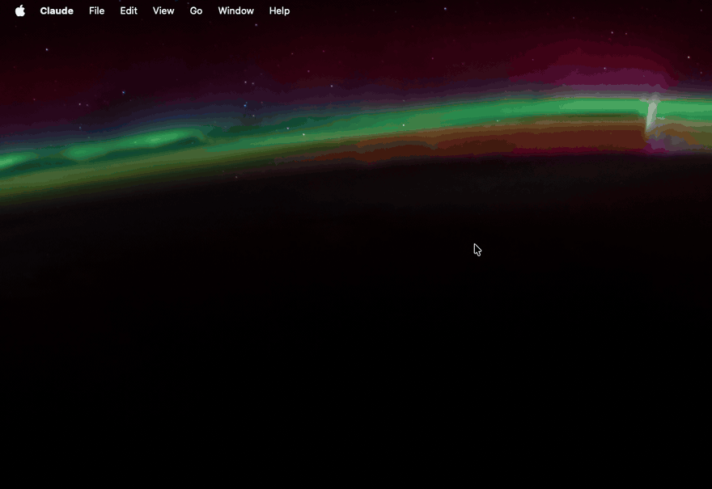
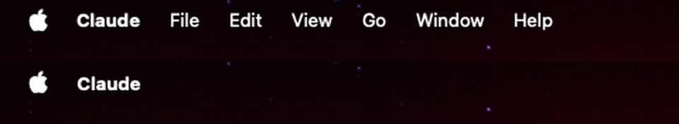
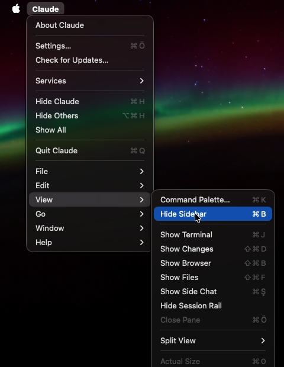

<p align="center">
  
</p>

<h1 align="center">Tuck</h1>

<p align="center">
  <b>macOS için daha sakin bir menü çubuğu.</b><br>
  Tuck her uygulamanın Dosya, Düzen, Görünüm… menülerini uygulamanın adının altına katlar, gözünün önünde yalnız ad kalır.
</p>

<p align="center">
  <a href="README.md">English</a> · <b>Türkçe</b>
</p>

<p align="center">
  
</p>

---

macOS menü çubuğunun sol yarısı, günde birkaç kez açtığın menülerden oluşan bir sıra: *Dosya, Düzen, Görünüm, Git, Pencere, Yardım*, bazı uygulamalarda on tane daha. Tuck bu sırayı kaldırır ve yalnız uygulamanın adını bırakır. Ada tıklarsın, bütün menüler bir kat aşağıda oradadır.

Tuck üç fikir üzerine kurulu:

1. **Yalnız ad kalır.** Apple menüsünün yanında içinde olduğun uygulamanın adını görürsün, başka hiçbir şey yok. Ok ya da işaret de yok: menülerin adın altında olduğunu bir kez öğrendikten sonra ad yeter.
2. **Hiçbir şey kaybolmaz.** Ada tıklayınca uygulamanın kendi menüsü, öbür bütün menüleri alt menü olarak içinde açılır. Oradan bir madde seçmek uygulamadaki gerçek maddeye basar, yani her şey eskisi gibi çalışır. Klavye kısayolları Tuck'tan hiç geçmez, her zamanki gibi çalışır.
3. **Hep böyleymiş gibi görünür.** Tuck menülerin üstüne koyduğu şeridin arkasına masaüstünü canlı olarak çizer; Aerial gibi hareketli duvar kağıtlarında bile ek yeri belli olmaz. Tam ekran uygulama gösteren bir ekranda kenara çekilir.

Menü çubuğu olan her uygulamada çalışır: Finder'dan Safari'ye, Electron uygulamalarına kadar. Mac'inden dışarı hiçbir şey çıkmaz: hesap yok, internet bağlantısı yok, takip yok.

*Tuck*, İngilizcede bir şeyi kıvırıp gözden saklamak demek. Tuck'ın kendi menüsü Türkçe ve İngilizce.

## İçindekiler

- [Ne değişiyor](#ne-değişiyor)
- [Menüleri açmak](#menüleri-açmak)
- [Her uygulamada, her ekranda](#her-uygulamada-her-ekranda)
- [Menü çubuğu simgesi](#menü-çubuğu-simgesi)
- [Kurulum](#kurulum)
- [İzinler ve gizlilik](#i̇zinler-ve-gizlilik)
- [İzinlerin derlemeler arasında korunması](#i̇zinlerin-derlemeler-arasında-korunması)
- [Nasıl çalışıyor](#nasıl-çalışıyor)
- [Sınırlar](#sınırlar)
- [Derleme ve katkı](#derleme-ve-katkı)
- [Lisans](#lisans)

## Ne değişiyor

<p align="center">
  
</p>

Üstte menü çubuğu macOS'un gösterdiği gibi. Altta aynı uygulama, Tuck açıkken. Apple menüsü ve menü çubuğunun sağ tarafındaki her şey (saat, Denetim Merkezi, öbür uygulamaların simgeleri) olduğu gibi kalır; Tuck yalnız öndeki uygulamaya ait menü sırasına dokunur.

## Menüleri açmak



Uygulamanın adına tıkla. Tek bir menü açılır:

- **En üstte uygulamanın kendi menüsü:** *Hakkında*, *Ayarlar…*, *Gizle*, *Çık* ve uygulamanın orada tuttuğu başka ne varsa, adına normalde tıkladığında nasıl görünüyorsa öyle.
- **Bir ayracın altında öbür bütün menüler, alt menü olarak:** *Dosya*, *Düzen*, *Görünüm*… uygulamanın kendi sırasıyla. Üzerine gelince açılır.

Maddeler onay işaretlerini, klavye kısayollarını ve o an seçilebilir olup olmadıklarını gösterir; Tuck bunların hepsini menüyü açtığın anda uygulamadan okur. *Yer İşaretleri* ya da *Geçmiş* gibi büyük menüler ancak üzerine geldiğinde okunur; menü yüzlerce maddesi olan uygulamalarda bile hemen açılır.

Bir madde seçmek uygulamadaki aynı maddeye basar. Uygulama farkı anlamaz.

<br clear="right">

## Her uygulamada, her ekranda

<p align="center">
  
</p>

- **Her uygulama:** uygulama değiştirdiğinde ad da değişir. Çalışırken menüsünü değiştiren uygulamalar, örneğin sekme ya da pencere değiştirince, onlar da izlenir.
- **Birden fazla ekran:** *Ekranlar ayrı alanlara sahip* açıkken (macOS'ta varsayılan), her ekranın kendi menü çubuğu olur ve Tuck şeridini hepsine koyar.
- **Tam ekran:** bir uygulama tam ekrana geçtiğinde ya da tarayıcıda bir videoyu çift tıklayıp tam ekran yaptığında o ekranın menü çubuğu gizlenir. Tuck bunu fark eder ve şeridini yalnız o ekrandan kaldırır, öbür ekranlar toplu kalır. Tam ekran uygulamanın menü çubuğunun altından başladığı çentikli MacBook'larda da çalışır.

## Menü çubuğu simgesi

Tuck menü çubuğunda küçük bir simge olarak durur; penceresi ya da Dock simgesi yok. Menüsünde üç madde var:

| | |
|---|---|
| **Menüleri topla** | Toplamayı açar ya da kapatır. Kapalıyken menü çubuğu tamamen macOS'unki. |
| **Açılışta başlat** | Varsayılan olarak açık: Tuck ilk açılışta kendini giriş öğelerine ekler, hep orada olur. |
| **Tuck'tan çık** | Çıkar. Menüler hemen geri gelir. |

## Kurulum

Tuck **macOS 14 Sonoma ya da sonrası** ve **Apple Silicon** ister. Henüz hazır bir indirme yok, kendin derliyorsun; yaklaşık bir dakika sürer ve Xcode değil yalnız Xcode Komut Satırı Araçları gerekir (`xcode-select --install`).

```sh
git clone https://github.com/serbestonline/Tuck.git
cd Tuck
./build.sh --install
open ~/Applications/Tuck.app
```

`build.sh` Tuck'ı derler, simgesini çizer ve `Tuck.app`'i `build/` klasörüne koyar; `--install` onu ayrıca ev klasöründeki `Applications` klasörüne kopyalar.

İlk açılışta macOS bir sonraki bölümde anlatılan iki izni ister. İkisini de ver, sonra menü çubuğu simgesinden Tuck'tan çık ve yeniden aç; macOS ekran kaydı iznini ancak uygulama yeniden başlayınca uygular.

> **Tuck, Ekran Kaydı listesinde yok mu?** macOS bir uygulamayı o listeye ancak bir kez kayıt denedikten sonra ekler. Listenin altındaki **+**'ya bas, **⌘⇧G**'ye bas, `~/Applications/Tuck.app` yapıştır, *Aç*'ı seç ve anahtarını aç.

Kaldırmak için Tuck'tan çık, `~/Applications/Tuck.app`'i sil; *Sistem Ayarları › Genel › Giriş Öğeleri*'nden ve aşağıdaki iki gizlilik listesinden de çıkar.

## İzinler ve gizlilik

Tuck *Sistem Ayarları › Gizlilik ve Güvenlik*'te iki izin ister. İkisi de gerekli ve her birinin tek bir işi var.

| İzin | Tuck onunla ne yapıyor |
|---|---|
| **Erişilebilirlik** | Öndeki uygulamanın menü çubuğunu okur (adlar, konumlar, maddeler, kısayollar) ve toplu menüde seçtiğin maddeye basar. Bu izin olmadan Tuck hiçbir şey yapmaz. |
| **Ekran ve Sistem Sesi Kaydı** | Menü çubuğunun arkasındaki **yalnız masaüstü katmanını** (duvar kağıdını) saniyede iki kez yakalar ki menülerin üstündeki şerit onu yeniden çizebilsin. Pencereler, menülerin kendisi ve Tuck'ın şeridi bu görüntüye girmez. Hiçbir şey kaydedilmez ya da bir yere gönderilmez; Tuck asla ses kaydetmez. |

Tuck'ta internete bağlanan hiçbir kod yok. Tek bir tercih saklar (kendini giriş öğelerine ekleyip eklemediği), başka hiçbir şey saklamaz.

## İzinlerin derlemeler arasında korunması

macOS bu izinleri uygulamanın kod imzasına bağlar. `build.sh` Tuck'ı varsayılan olarak *geçici* (ad hoc) imzalar ve geçici imza her derlemede değişir; her yeni derlemeden sonra macOS Tuck'ı tanımaz ve onu iki listeden silip yeniden eklemen gerekir.

Bunu önlemek için değişmeyen bir sertifikayla imzala:

1. **Anahtar Zinciri Erişimi**'ni aç, *Anahtar Zinciri Erişimi › Sertifika Yardımcısı › Sertifika Oluştur…*'u seç.
2. Bir ad ver, *Kimlik Türü*'nü **Kendinden İmzalı Kök**, *Sertifika Türü*'nü **Kod İmzalama** yap ve oluştur.
3. O adla derle:

```sh
TUCK_SIGN_IDENTITY="Sertifikanın adı" ./build.sh --install
```

İlk imzalı derlemeden sonra izinleri bir kez daha ver; bundan sonra her derlemede korunurlar. Sertifika yalnız senin anahtar zincirinde durur ve yalnız senin Mac'inde geçerlidir.

## Nasıl çalışıyor

macOS bir uygulamanın başka bir uygulamanın menülerini silmesine izin vermez, bu yüzden Tuck onları örter.

1. **Okuma.** Uygulama değiştirdiğinde ve aynı uygulamada kaldığın sürece saniyede iki kez, Tuck öndeki uygulamanın menü çubuğunu Erişilebilirlik arayüzünden ister: uygulamanın adının nerede durduğunu, son menüsünün nerede bittiğini ve menülerin kendisini.
2. **Örtme.** Her ekranın menü çubuğuna, menü çubuğunun bir kat üstünde duran kenarsız bir şerit koyar. Şerit Apple menüsünün hemen ardından başlar, çünkü gerçek menülerin vurgusu kenarlarından birkaç nokta taşar; son menünün biraz ötesinde biter.
3. **Çizme.** Şeridin arkasına ScreenCaptureKit ile saniyede iki kez alınan, yalnız masaüstü katmanının canlı görüntüsünü çizer; şerit duvar kağıdının ta kendisi olur. Sonra uygulamanın adını menü çubuğunun aynı kalın yazı tipiyle, duvar kağıdının o noktadaki parlaklığına göre beyaz ya da siyah yazar.
4. **Aynalama.** Ada tıklayınca uygulamanın menülerinden sıradan bir macOS menüsü kurar. Alt menüler üzerine geldiğin anda doldurulur. Bir madde seçmek gerçek maddeye Erişilebilirlik'in *bas* eylemini gönderir.
5. **Tam ekran.** Tam ekran bir uygulama o ekranın menü çubuğunun üstüne ekran genişliğinde bir pencere koyar. Normal pencereler ve menü çubuğu simgeleri bunu asla yapmaz; Tuck o ekranda kenara çekilmesi gerektiğini buradan anlar.

## Sınırlar

- **Gerçek menüler altta duruyor.** Tuck onları örter, silmez. Menü çubuğunun klavyeyle gezilmesi (*Control-F2*) ve VoiceOver onlara yine ulaşır.
- **Açılınca doldurulan menüler** (son kullanılanlar, pencere listeleri) alt menüyü açtığın andaki hallerini gösterir.
- **Bazı kısayollar gösterilmez:** ok tuşları ya da F tuşları gibi kısayollar toplu menüde yazmaz, ama uygulamada çalışmaya devam eder.
- **Menü çubuğu arka planı.** Sistem Ayarları'nda *Menü çubuğu arka planını göster* açıksa, duvar kağıdını çizen şerit çubuktan ayrı görünür.
- **Büyük macOS güncellemeleri** menü çubuğunun katmanlarını değiştirebilir. Bir güncellemeden sonra şerit tuhaf görünürse simgeden *Menüleri topla*'yı kapat ve bir issue aç.

## Derleme ve katkı

Proje birkaç Swift dosyası ve iki betikten oluşuyor, `swiftc` ile derleniyor; Xcode projesi yok.

| Dosya | Ne yapıyor |
|---|---|
| `Sources/main.swift` | Uygulamanın başlaması, menü çubuğu simgesi ve menüsü, izinler, açılışta başlatma ve iç test |
| `Sources/MenuMirror.swift` | Uygulamanın menü çubuğunu Erişilebilirlik ile okumak ve toplu menüye aynalamak |
| `Sources/Strip.swift` | Her ekrandaki şerit: yerleşim, tam ekranı anlama ve canlı duvar kağıdı yakalama |
| `Sources/Record.swift` | Bu README'deki GIF'leri üreten kayıt modu |
| `build.sh` | `Tuck.app`'i derler, simgeyi çizer ve imzalar |
| `scripts/make_icon.swift` | Uygulama simgesini çizer |
| `scripts/make_media.sh` | Tuck'ı kaydeder ve `assets/` içindeki görselleri ve GIF'leri yeniden üretir |

```sh
./build.sh                                # build/Tuck.app
build/Tuck.app/Contents/MacOS/Tuck --selftest
./scripts/make_media.sh                   # fareyi ~30 sn oynatır; dokunma
```

İç test Tuck'ın dayandığı geometriyi sınar: bir menü çubuğunun hangi ekrana ait olduğunu, ikinci ekranda şeridin nereye oturduğunu ve bir ekranın ne zaman tam ekran sayıldığını.

Hata bildirimleri ve fikirler issue olarak memnuniyetle karşılanır.

## Lisans

Tuck **kaynağı açık ama açık kaynak değil.** Kodu okuyabilir, derleyebilir ve kendi bilgisayarlarında kişisel, ticari olmayan amaçla kullanabilirsin. Kopyalamak, yeniden dağıtmak, değiştirilmiş sürümler yayınlamak ve ticari kullanım yazılı izne bağlı. Metnin tamamı için [LICENSE](LICENSE).
